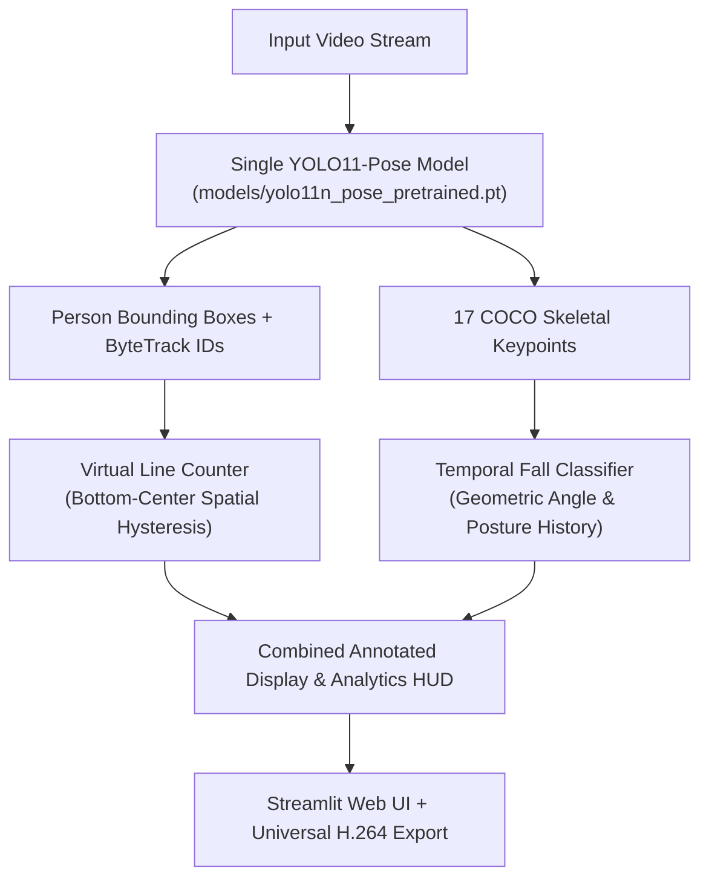

# AI Person Fall Detection & Virtual Line People Counter

A robust computer vision system combining **YOLO11 Pose Estimation**, **ByteTrack Multi-Object Tracking**, **Temporal Posture Classification**, and a **Virtual Line-Crossing People Counter** into a unified, interactive Streamlit application.

---

## Key System Capabilities

### 1. Human Posture & Fall Detection Engine
- **Upright Posture Tracking (`STANDING`)**: Evaluates geometric skeletal vectors (shoulders to hips) with `torso_angle < 35°` and bounding box aspect ratio `< 0.85`.
- **Dynamic Transition Classification (`FALLING`)**: Detects high-velocity transitions from an upright orientation toward a horizontal posture within an active temporal window ($2 \times \text{FPS}$).
- **Horizontal State Confirmation (`FALLEN`)**: Confirms fallen state when torso angle exceeds $55°$ and aspect ratio exceeds $0.80$ sustained across a configurable consecutive frame threshold (default: 5 frames).
- **Incident Validation Logic**: Only confirmed transitions (`STANDING` $\to$ `FALLING` $\to$ `FALLEN`) register as fall incidents. Pre-existing horizontal postures (e.g., someone already lying down or sleeping) do not trigger false alerts.
- **Alert Banners**: High-contrast, dynamic visual banners highlight active falling transitions and fallen states on-screen.

### 2. Virtual Line-Crossing People Counter
- **Persistent Identification**: Integrates ByteTrack (`bytetrack.yaml` via Ultralytics) to assign persistent tracking IDs across consecutive frames.
- **Configurable Virtual Line**: Places a vertical boundary at any percentage of the frame width (default: 50%).
- **Bottom-Center Spatial Tracking**: Tracks the ground-contact point $(x, y)$ of each person's bounding box across frames.
- **Hysteresis Corridor (Deadband)**: Employs a dynamic buffer zone $[x_{\text{line}} - \delta, x_{\text{line}} + \delta]$ to prevent duplicate counts from bounding-box jitter, individuals lingering near the line, or momentary detection drops.
- **Directional Counting Rules**:
  - **Left to Right ($L \to R$)**: Increases right-side people count by 1; increments total entries.
  - **Right to Left ($R \to L$)**: Decreases right-side people count by 1; increments total exits.
  - **Non-Negative Guard**: Clamps right-side people count at $\ge 0$ by default (configurable).
  - **Crossing Indicators**: Displays temporary directional notifications (`--> L to R (+1)` or `<-- R to L (-1)`) and an integrated Heads-Up Display (HUD).
- **Decoupled Architecture**: Fall detection and people counting run completely independently—a fall does not alter line counts, and line crossings do not trigger posture alerts.

### 3. Interactive Web Dashboard (Streamlit)
- **Live Frame Streaming**: Real-time side-by-side view showing the original uploaded video and the annotated output feed.
- **On-Screen Frame Scrubbing & Replay**: Interactive slider to inspect individual frames with active state banners and replay analyzed sequences.
- **Persistent Session State**: Full analysis metrics, frame controls, and download buttons persist across user interactions without resetting.
- **Universal MP4 Video Export**: Automatically converts processed output to standard H.264 MP4 (`yuv420p` via `ffmpeg`), ensuring universal compatibility across Windows Media Player, QuickTime, iOS, Android, and web browsers.

---

## Architecture Overview



---

## Posture and State Definitions

| State | Geometric Conditions | Visual Indicator |
| :--- | :--- | :---: |
| **`STANDING`** | `torso_angle < 35°` and `aspect_ratio < 0.85` | 🟢 Green Bounding Box & HUD |
| **`FALLING`** | Dynamic transition from upright toward horizontal within $2 \times \text{FPS}$ | 🟠 Orange Box + Banner Alert |
| **`FALLEN`** | `torso_angle > 55°` and `aspect_ratio > 0.80` sustained for $\ge N$ frames | 🔴 Red Box + Audio-Visual Alert |
| **`UNCERTAIN`** | Keypoints occluded, low confidence ($< 0.25$), or non-conforming posture | ⚪ Neutral Gray Box |

---

## Project Structure

```text
FallDetection/
├── app.py                         # Streamlit web application & export interface
├── fall_detection.py              # Pose estimation, temporal classifier & VirtualLineCounter
├── test_line_counter.py           # Unit test suite verifying 6 line-crossing scenarios
├── requirements.txt               # Application dependencies
├── README.md                      # Project documentation
├── models/
│   ├── yolo11n_pose_pretrained.pt # Pretrained YOLO11 pose weights (default)
│   └── yolo11n-pose.pt            # Compatibility alias checkpoint
└── outputs/                       # Destination directory for annotated video exports
```

---

## Installation & Setup

### 1. Prerequisites
- Python 3.10 – 3.13
- FFmpeg (recommended for universal H.264 video encoding)

### 2. Activate Virtual Environment (PowerShell)
```powershell
.\venv\Scripts\Activate.ps1
```
*(Or initialize a new virtual environment: `python -m venv venv`)*

### 3. Install Dependencies
```powershell
pip install -r requirements.txt
```

---

## Running the Application

Launch the Streamlit web dashboard:

```powershell
streamlit run app.py
```

Access the interface in your browser at `http://localhost:8501`.

### Operational Workflow:
1. **Upload Video**: Choose any `.mp4`, `.avi`, `.mov`, or `.mkv` human activity recording.
2. **Configure Parameters (Sidebar)**:
   - **Detection Confidence**: Keypoint sensitivity threshold (default: 0.35).
   - **Fallen Frames Threshold**: Consecutive horizontal frames required to confirm a fall (default: 5).
   - **Display Pose Keypoints**: Toggle 17-point skeletal visualization.
   - **Enable Line Counter**: Toggle virtual boundary counting.
   - **Virtual Line Position**: Set vertical line coordinate (10% to 90% frame width).
   - **Initial Right-Side Count**: Set starting count (default: 0).
   - **Allow Negative Count**: Toggle negative boundary behavior.
3. **Analyze**: Click **Analyze Video** to process and view real-time posture feeds and counts.
4. **Inspect & Download**:
   - Scrub through individual frames with the on-screen slider.
   - Review detection metrics (Frames, Fall Events, Processing FPS, Posture Counts, People Counts).
   - Click **Download Annotated Video** to save the fully rendered H.264 MP4 file.

---

## Automated Verification Tests

The project includes an automated test suite validating multi-scenario crossing dynamics against simulated bounding-box trajectories:

```powershell
python test_line_counter.py
```

### Verified Scenarios:
1. **Left to Right ($L \to R$)**: Right-side count increments by 1.
2. **Right to Left ($R \to L$)**: Right-side count decrements by 1.
3. **Round Trip ($L \to R \to L$)**: Net count change returns to zero.
4. **Boundary Hover & Jitter**: Person lingering inside the deadband produces zero duplicate counts.
5. **Simultaneous Multi-Person Crossing**: Multiple people crossing in opposite directions are tracked independently.
6. **Temporary Detection Loss**: Occlusion or brief detection gaps do not trigger duplicate crossing events.
7. **Boundary Clamping**: Non-negative vs. negative counting rules operate as configured.

---

## Limitations & Operational Considerations

- **Perspective & Angles**: The virtual line operates as a vertical 2D partition in image space. In steep angled cameras, positioning the line according to ground-plane orientation provides optimal tracking.
- **Occlusion Recovery**: If a person is completely obscured for an extended period, ByteTrack may allocate a new tracking ID upon reappearance.
- **Lighting & Keypoint Quality**: Heavy shadows or low-contrast environments may reduce pose confidence, resulting in transient `UNCERTAIN` posture states.
