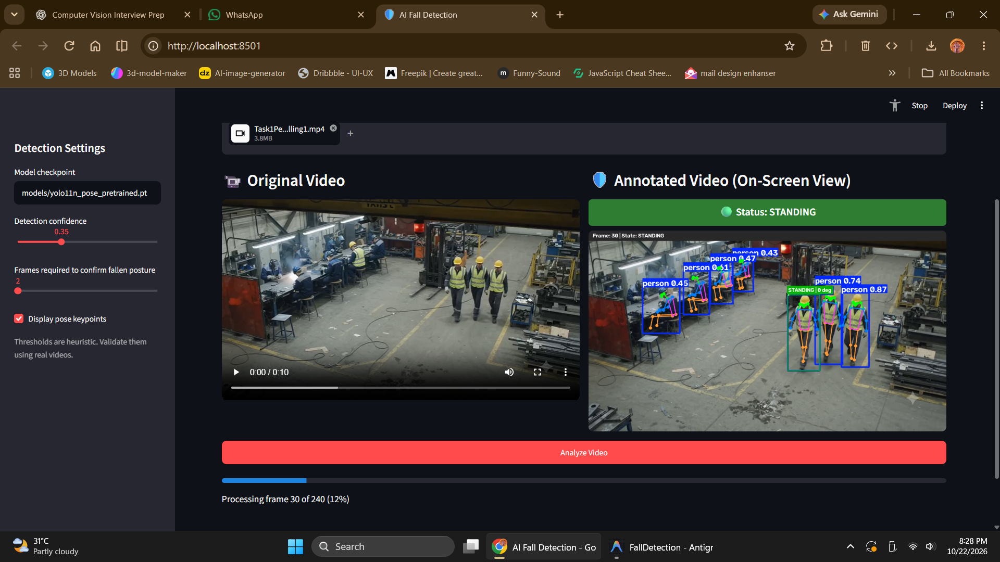
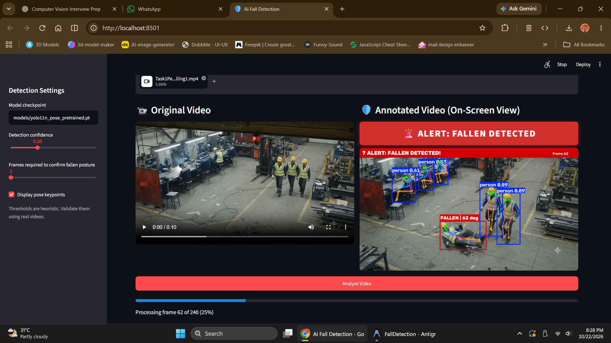

# Human Fall Detection System

An automated computer vision system for posture classification and fall event detection in video feeds using YOLO11 pose estimation and temporal transition analysis.

---

## Detection Previews

| Standing Posture Detection | Fallen State Detection |
| :---: | :---: |
|  |  |

---

## Architecture Overview

The system decouples visual feature extraction, temporal posture classification, and multi-object tracking:

1. **Pose Estimation & Multi-Object Tracking (`models/yolo11n_pose_pretrained.pt`)**
   - Utilizes the Ultralytics YOLO11 Nano Pose model (`yolo11n-pose`).
   - Detects person instances, extracts 17 COCO skeletal keypoints, and assigns persistent tracking IDs using ByteTrack (`model.track(persist=True, tracker="bytetrack.yaml")`).
   - *Note:* The model checkpoint provides spatial keypoint detection; classification of fall dynamics is performed by the temporal state engine.

2. **Temporal Posture Classifier (`fall_detection.py`)**
   - Evaluates geometric indicators per frame, including torso orientation angle (`arctan2(|dx|, |dy|)`) and bounding box aspect ratio (width / height).
   - Tracks temporal state progression across consecutive frames to differentiate transient movements and horizontal resting states from actual fall transitions.

3. **Virtual Line-Crossing People Counter (`fall_detection.py:VirtualLineCounter`)**
   - Draws a configurable vertical line across the frame (default: 50% width).
   - Tracks the bottom-center point of each person's bounding box across frames.
   - Utilizes hysteresis deadband corridor to prevent jitter and duplicate counting when standing near the line.
   - Counting rules:
     - **Left to Right (L->R)**: Increments right-side count by 1.
     - **Right to Left (R->L)**: Decrements right-side count by 1 (non-negative by default).
     - **Independent**: Operates in parallel without interfering with fall detection alerts.

---

## Posture and State Definitions

- **`STANDING`**: Person maintains an upright vertical posture (`torso_angle < 35°` and `aspect_ratio < 0.85`).
- **`FALLING`**: Person exhibits a dynamic transition from an upright to a horizontal orientation within an active temporal window ($2 \times \text{FPS}$).
- **`FALLEN`**: Person remains in a horizontal orientation (`torso_angle > 55°` and `aspect_ratio > 0.80`) for at least the designated frame threshold (default: 5 consecutive frames).
- **`UNCERTAIN`**: Keypoints are occluded, confidence is below threshold (< 0.25), no subject is detected, or body orientation falls outside defined thresholds.

> **Fall Transition Logic:** A valid fall incident is logged only when a confirmed progression occurs: `STANDING` -> `FALLING` -> sustained `FALLEN`. Pre-existing horizontal postures without an observed descent are classified as horizontal without triggering a fall alert.

---

## Project Structure

```text
FallDetection/
├── app.py                         # Streamlit web dashboard and visualization interface
├── fall_detection.py              # Pose estimation, temporal state logic, and VirtualLineCounter
├── requirements.txt               # Application dependencies (including lapx for ByteTrack)
├── test_line_counter.py           # Unit tests for line-crossing counting scenarios
├── test_pipeline.py               # End-to-end synthetic video validation test
├── README.md                      # Project documentation
├── Standing.png                   # Sample preview: Standing posture
├── Fallen.png                     # Sample preview: Fallen posture
├── models/
│   ├── yolo11n_pose_pretrained.pt # Pretrained YOLO11 pose weights
│   └── yolo11n-pose.pt            # Compatibility alias / model weights
└── outputs/                       # Destination directory for processed video outputs
```

---

## Installation and Setup

### 1. Prerequisites
- Python 3.10 - 3.13
- Virtual environment (recommended)

### 2. Activate Virtual Environment (PowerShell)
```powershell
.\venv\Scripts\Activate.ps1
```
*(Or initialize a new virtual environment: `python -m venv venv`)*

### 3. Install Dependencies
```powershell
pip install -r requirements.txt
```

---

## Running the Application

Launch the Streamlit web dashboard:

```powershell
streamlit run app.py
```

Access the interface in your browser at `http://localhost:8501`.

### Operational Workflow:
1. Upload a target video file (`.mp4`, `.avi`, `.mov`, `.mkv`).
2. Configure detection and tracking parameters in the sidebar:
   - **Detection Confidence**: Threshold for person keypoint detection (default: 0.35).
   - **Fallen Frames Threshold**: Number of consecutive horizontal frames required to confirm a `FALLEN` state (default: 5).
   - **Keypoint Overlay**: Toggle skeletal overlay visualization.
   - **Enable Virtual Line Counter**: Toggle line-crossing counter.
   - **Line Position**: Configurable vertical line placement (10% to 90% of frame width, default: 50%).
   - **Initial Right-Side Count**: Set initial count (default: 0).
   - **Allow Negative Count**: Toggle negative counting if needed.
3. Select **Analyze Video** to begin processing.
4. Review real-time progress, live video playback, people counter HUD metrics, state distribution summary, and download the annotated output video.

---

## Automated Tests

Run unit tests verifying the 6 simulated line-crossing scenarios:
```powershell
python test_line_counter.py
```

Run end-to-end pipeline test:
```powershell
python test_pipeline.py
```

---

## Limitations and Future Improvements

- **Camera Placement and Lighting:** Optimal performance occurs with elevated or wall-mounted perspectives where torso and hip keypoints remain visible.
- **Occlusions:** Obscured skeletal landmarks automatically trigger the fallback `UNCERTAIN` classification.
- **Tracking ID Continuity:** If a person is occluded for an extended period, ByteTrack may assign a new tracking ID upon reappearance.
- **Custom Model Training:** The current pipeline implements rule-based temporal heuristics on top of spatial keypoint coordinates. For advanced operational deployment:
  - Benchmark against standard public datasets (e.g., UR Fall Detection, Le2i Fall Detection, Multiple Cameras Fall Dataset).
  - Train temporal graph convolutional networks (e.g., ST-GCN) or spatio-temporal action recognition architectures directly on sequence data.
